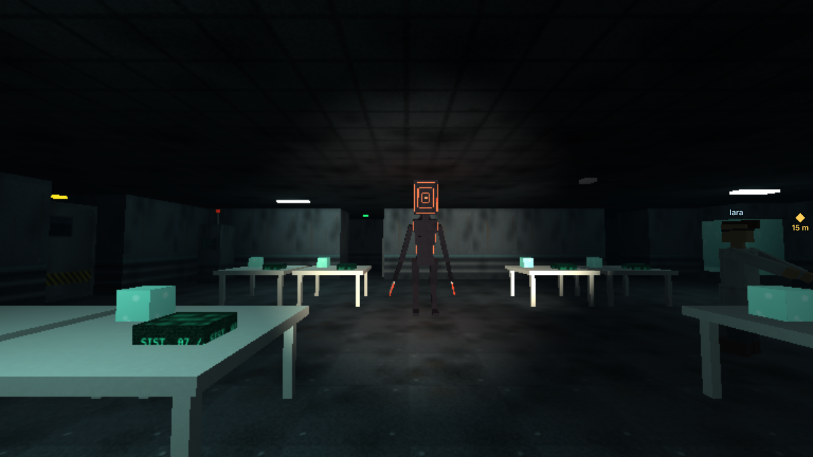

# VÉU: Ecos da Ruptura

Terror multiplayer assimétrico para navegador: **1 entidade contra até 8 sobreviventes** em uma instalação científica submarina. Projeto original — personagens, criatura, mapa, texturas, sons e interface foram criados do zero (texturas e áudio são gerados por código; não há arquivos de terceiros).



## Estado atual — versão 0.1 (primeira versão jogável)

| Funciona e foi testado | Ainda não implementado |
|---|---|
| Contas (cadastro, login, convidado), sessões seguras | Mapas 2 e 3 (Setor Helix, Estação Ártica) — projetados em `docs/DESIGN.md` |
| Salas com código, lista pública, partida rápida, chat, anfitrião, expulsar | Entidades 2 e 3 (A Tecelã, O Hiato) — projetadas em `docs/DESIGN.md` |
| Sorteio da entidade, contagem, carregamento, retorno ao lobby | Adaptador PostgreSQL (schema pronto; falta o código com o pacote `pg`) |
| Mapa **Complexo Abissal** (8 áreas + corredores, túneis e 2 docas) | Animações por esqueleto/modelos importados (hoje são procedurais) |
| Sobreviventes: andar/correr/agachar, fôlego, vida, ferimento, queda, resgate, morte, espectador, inventário, cura, detector, sinalizador, lanterna, armários | Matchmaking por habilidade, denúncias, moderação |
| **Armas** (pistola P-50, fuzil FR-9, lança-chamas LC-3) e **suprimentos** de munição/combustível com coleta, limite e reposição pelo servidor; entidade pode ser destruída | Compensação de latência nos tiros (hoje o servidor usa a posição atual da entidade) |
| Entidade **O Reverberante**: ataque, Rastro, Eco Falso (Eco Biológico), Ruptura, Parasita, camuflagem, visão especial, evolução por Ressonância | Pagamentos reais (fora do escopo desta versão, por pedido) |
| Objetivos sorteados em 3 fases + fuga; vitória/derrota calculadas no servidor | |
| Progressão: nível, XP, fragmentos, conquistas, temporada, maestria, histórico, estatísticas, loja e personalização | |
| Voz WebRTC com proximidade, mudo por jogador, apertar-para-falar | |
| Controles de PC (configuráveis) e de toque; configurações de gráficos e áudio | |

## Como rodar

Requisitos: **Node.js 20+** e um navegador com WebGL2 (Chrome, Edge, Firefox, Safari 15+).

```bash
npm install
npm run build
npm start            # http://localhost:8080
```

Abra duas janelas (ou dois dispositivos na mesma rede, em `http://IP-DO-PC:8080`), entre com contas diferentes (ou como convidado), crie uma sala em uma e entre pelo código na outra. São necessários 2 jogadores para iniciar.

Desenvolvimento com recompilação automática: `npm run dev`.

### Testes

```bash
npm test               # unitários (23) + armas e suprimentos (33) + partida completa com bots (56)
npm run test:browser   # Chrome real: interface, partida 3D, armas, voz WebRTC, resultados (33)
bash scripts/check-schema.sh   # valida o schema PostgreSQL numa instância temporária
npm run typecheck
```

`npm run test:browser` usa o Playwright; defina `CHROME=/caminho/do/chrome` se necessário.

## Controles (padrão — todos configuráveis)

| PC | Sobrevivente | Entidade |
|---|---|---|
| WASD / mouse | mover / olhar | mover / olhar |
| Shift | correr | — |
| Ctrl | agachar | espreitar (camuflagem) |
| E (segurar) | interagir, entregar, consertar, resgatar | portas, vasculhar armários |
| F | lanterna | Parasita |
| Botão esq. / Q ou roda / R | atirar / trocar arma / recarregar | — |
| Tab / 1–4 | inventário / usar item | — |
| Botão esq. | — | atacar |
| Q / R / Espaço | — | Rastro / Eco Falso / Ruptura |
| Z ou roda | — | trocar o som do Eco Falso |
| C / V / Esc | câmera 1ª-3ª pessoa / falar / menu | idem |

No celular aparecem joystick, área de toque para olhar e botões de ação.

## Configuração de produção

| Variável | Uso |
|---|---|
| `PORT`, `HOST` | endereço do servidor (padrão `0.0.0.0:8080`) |
| `DATA_FILE` | arquivo de dados (padrão `./data/db.json`) |
| `TRUST_PROXY=1` | atrás de proxy reverso (Nginx, Caddy) |
| `ALLOWED_ORIGINS` | origens aceitas no WebSocket, separadas por vírgula |
| `ANDROID_ASSETLINKS` | conteúdo do `assetlinks.json` gerado pelo PWABuilder (remove a barra de endereço do APK) |
| `ICE_SERVERS` | JSON com STUN/TURN para a voz, ex.: `[{"urls":"turn:turn.seudominio.com:3478","username":"u","credential":"s"}]` |

O que precisa ser providenciado fora do código: **HTTPS/WSS** (o microfone só funciona em HTTPS ou localhost), um **servidor TURN** (ex.: coturn) para voz entre redes restritivas, e — quando migrar — **PostgreSQL** (`server/db/schema.sql`). Detalhes em `docs/ARQUITETURA.md`.

## Celular / APK

O jogo funciona como aplicativo instalável (PWA) e pode virar APK. Passo a passo completo em **`docs/PUBLICAR-ANDROID.md`** (hospedagem no Render com `render.yaml` + geração do APK no PWABuilder).

## Documentação

- `docs/ARQUITETURA.md` — estrutura de pastas, tecnologias e justificativas, rede, segurança, desempenho.
- `docs/DESIGN.md` — documento de game design: regras, entidades, mapas, objetivos, balanceamento.
- `docs/ROADMAP.md` — plano por etapas com o que foi concluído e o que falta.
- `docs/PUBLICAR-ANDROID.md` — hospedar o servidor e gerar o APK.
