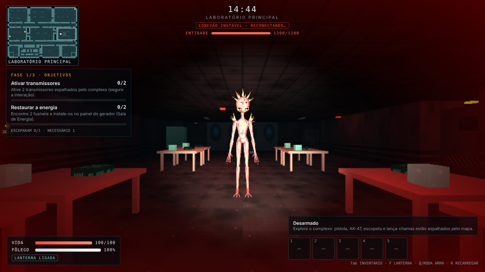
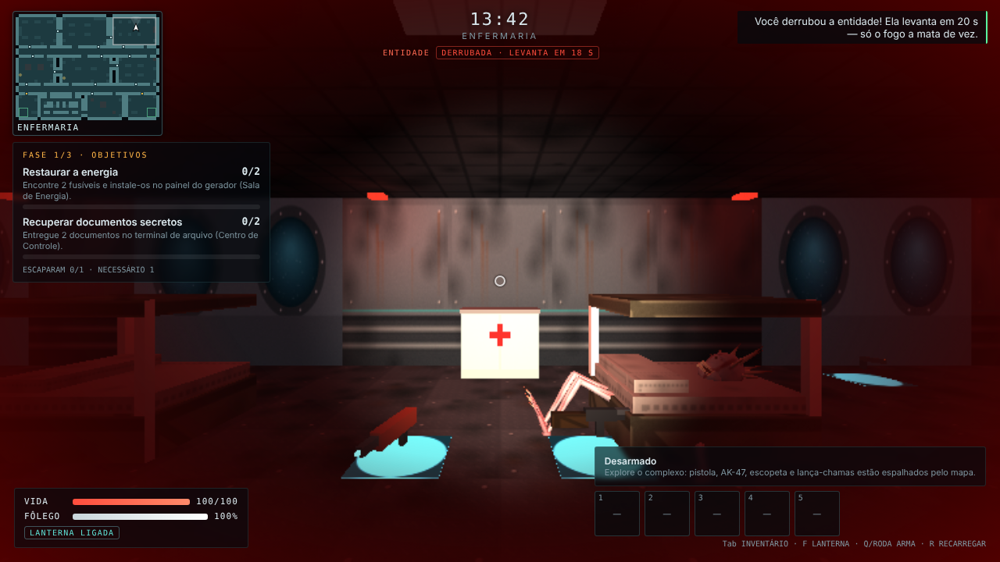

# VÉU: Ecos da Ruptura

Terror multiplayer assimétrico para navegador: **1 entidade contra até 8 sobreviventes** em uma instalação científica submarina. Projeto original — personagens, criatura, mapa, texturas, sons e interface foram criados do zero (texturas e áudio são gerados por código; não há arquivos de terceiros).



## Estado atual — versão 0.3

| Funciona e foi testado | Ainda não implementado |
|---|---|
| Contas (cadastro, login, convidado), sessões seguras, **progresso permanente salvo automaticamente no servidor** | Mapas 2 e 3 (Setor Helix, Estação Ártica) — projetados em `docs/DESIGN.md` |
| **Sorteio de funções pelo servidor**: ninguém escolhe; 1 entidade + até 8 humanos (9 jogadores), sorteio justo (quem foi menos vezes entidade tem prioridade) e apresentação "Você é a Entidade / Você é humano" | Entidades 2 e 3 (A Tecelã, O Hiato) — projetadas em `docs/DESIGN.md` |
| **XP sem limite** (o nível continua indo até 50) e **ranking semanal** que zera toda segunda 00:00 (Brasília), com contagem regressiva, histórico das semanas anteriores e ranking geral/vitórias | Adaptador PostgreSQL (schema pronto e validado; falta o código com o pacote `pg`) — no plano gratuito do Render os dados somem a cada reinício |
| **Armas espalhadas pelo mapa** (ninguém começa armado): pistola, **AK-47**, **escopeta** (6 cartuchos, chumbos com dispersão e queda por distância) e **lança-chamas** funcional (combustível, alcance, fogo, sem atravessar parede); quantidades máximas por partida | Modelos esculpidos por artista (os atuais são malhas orgânicas procedurais) |
| **Inventário com pilhas**: kit, fusível e documento até 2 cada (um espaço por tipo), aviso "Inventário cheio de…" | Compensação de latência nos tiros |
| **Mais munição e itens** (39 pontos de suprimento + 20 pontos de arma, todos validados dentro de salas) | Testes em celulares reais (só emulação de tela/toque no Chrome) |
| **Caixa Médica** na Enfermaria: humanos e entidade usam, segurar 1,5 s cura 35% da vida máxima, uso ilimitado e sem recarga | Pagamentos reais (fora do escopo, por pedido) |
| **Entidade não regenera**; ao zerar a vida ela **cai derrubada** (20 s configuráveis) e levanta com vida cheia; **só o lança-chamas a mata de vez** → vitória imediata dos humanos | |
| **Melhorias de vida** (humano 100→140, entidade 1200→1560) e **Poder de fogo**; tudo validado no servidor | |
| **Minimapa com nomes reais das salas** e sala atual sempre visível | |
| Códigos **PARAENSE01**, **1MPARAENSE** (1.000.000 de moedas) e **2MPARAENSE** (2.000.000), uma vez por conta | |
| Amigos, presença, convites, melhorias permanentes, portas automáticas, estamina, iluminação, assistência de mira, chat, voz WebRTC, objetivos em 3 fases, espectador, PWA/APK | |



## Como rodar

Requisitos: **Node.js 20+** e um navegador com WebGL2 (Chrome, Edge, Firefox, Safari 15+).

```bash
npm install
npm run build
npm start            # http://localhost:8080
```

Abra duas janelas (ou dois dispositivos na mesma rede, em `http://IP-DO-PC:8080`), entre com contas diferentes (ou como convidado), crie uma sala em uma e entre pelo código na outra. São necessários 2 jogadores para iniciar.

Desenvolvimento com recompilação automática: `npm run dev`.

### Testes

```bash
npm test               # unitários (71) + balanceamento simulado (67) + contas/social/códigos/semana (82)
                       # + combate/portas/estamina (32) + armas em rede (22) + 9 jogadores (19)
                       # + partida completa com bots (56)          → 349 verificações
npm run test:browser   # Chrome real: menus, sorteio, ranking semanal, partida 3D, armas, minimapa,
                       # vida, entidade derrubada, voz, PC e celular (54 + 30)
node tests/model-shots.mjs     # capturas dos modelos 3D em várias poses (revisão visual)
bash scripts/check-schema.sh   # valida o schema PostgreSQL numa instância temporária
npm run typecheck
```

`npm run test:browser` usa o Playwright; defina `CHROME=/caminho/do/chrome` se necessário.

## Controles (padrão — todos configuráveis)

| PC | Sobrevivente | Entidade |
|---|---|---|
| WASD / mouse | mover / olhar | mover / olhar |
| Shift | correr | — |
| Ctrl | agachar | espreitar (camuflagem) |
| E (segurar) | interagir, pegar arma, Caixa Médica, resgatar | portas, armários, Caixa Médica |
| F | lanterna | Parasita |
| Botão esq. / Q ou roda / R | atirar (ou lança-chamas segurando) / trocar entre armas que possui / recarregar | — |
| Tab / 1–5 | inventário / usar item | — |
| Botão esq. / Botão dir. | — | atacar / Golpe Brutal (especial) |
| Q / R / Espaço | — | Rastro / Eco Falso / Ruptura |
| M | ampliar/reduzir minimapa | idem |
| T | ligar/desligar assistência de mira | — |
| Z ou roda | — | trocar o som do Eco Falso |
| C / V / Esc | câmera 1ª-3ª pessoa / falar / menu | idem |

No celular aparecem joystick, área de toque para olhar e botões de ação.

## Configuração de produção

| Variável | Uso |
|---|---|
| `PORT`, `HOST` | endereço do servidor (padrão `0.0.0.0:8080`) |
| `DATA_FILE` | arquivo de dados (padrão `./data/db.json`) |
| `TRUST_PROXY=1` | atrás de proxy reverso (Nginx, Caddy) |
| `ALLOWED_ORIGINS` | origens aceitas no WebSocket, separadas por vírgula |
| `ANDROID_ASSETLINKS` | conteúdo do `assetlinks.json` gerado pelo PWABuilder (remove a barra de endereço do APK) |
| `ENTITY_DOWN_TIME` | segundos que a entidade fica derrubada (padrão 20, entre 3 e 120) |
| `ADMIN_TOKEN` | senha da administração de códigos de presente (sem ela a rota fica bloqueada) |
| `ICE_SERVERS` | JSON com STUN/TURN para a voz, ex.: `[{"urls":"turn:turn.seudominio.com:3478","username":"u","credential":"s"}]` |

### Códigos de presente

Os códigos **PARAENSE01** (nível 50 + 20.000 fragmentos), **1MPARAENSE** (1.000.000 de moedas) e **2MPARAENSE** (2.000.000 de moedas) são criados automaticamente na inicialização; cada conta registrada usa cada código uma vez. Para cadastrar novos códigos sem mexer no código-fonte:

```bash
curl -X POST https://SEU-SERVIDOR/api/admin/codes -H "x-admin-token: $ADMIN_TOKEN" \
  -H "Content-Type: application/json" \
  -d '{"code":"NATAL2026","coins":1000,"xp":500,"maxUses":100,"expires":"2026-12-31T23:59:59Z"}'
curl https://SEU-SERVIDOR/api/admin/codes -H "x-admin-token: $ADMIN_TOKEN"   # lista códigos e usos
```

O que precisa ser providenciado fora do código: **HTTPS/WSS** (o microfone só funciona em HTTPS ou localhost), um **servidor TURN** (ex.: coturn) para voz entre redes restritivas, e — quando migrar — **PostgreSQL** (`server/db/schema.sql`). Detalhes em `docs/ARQUITETURA.md`.

## Celular / APK

O jogo funciona como aplicativo instalável (PWA) e pode virar APK. Passo a passo completo em **`docs/PUBLICAR-ANDROID.md`** (hospedagem no Render com `render.yaml` + geração do APK no PWABuilder).

## Documentação

- `docs/ARQUITETURA.md` — estrutura de pastas, tecnologias e justificativas, rede, segurança, desempenho.
- `docs/DESIGN.md` — documento de game design: regras, entidades, mapas, objetivos, balanceamento.
- `docs/ROADMAP.md` — plano por etapas com o que foi concluído e o que falta.
- `docs/PUBLICAR-ANDROID.md` — hospedar o servidor e gerar o APK.
- `docs/ENTREGA-v0.3.md` — o que mudou na versão 0.3, arquivos alterados, testes e pendências.
